<div align="center">

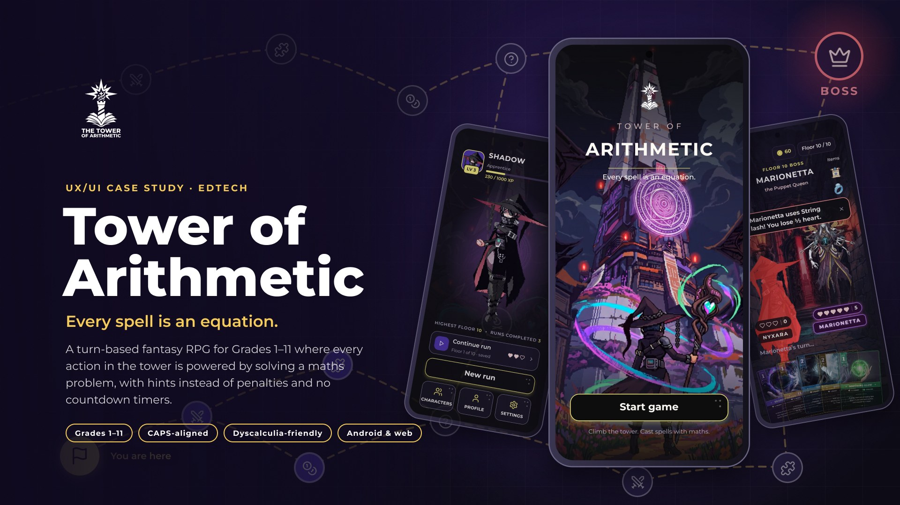

# Tower of Arithmetic

### Every spell is an equation.

A turn-based fantasy RPG for **Grades 1–11** where every action in the tower is powered by solving a maths problem, with **hints instead of penalties** and **no countdown timers**.

[](https://tower-of-arithmetic.vercel.app)


**Grades 1–11 · CAPS-aligned · Dyscalculia-friendly · Android & web**

</div>

---

## Contents

1. [About the project](#-about-the-project)
2. [The problem](#-the-problem)
3. [Research](#-research)
4. [Define: persona & problem statement](#-define-persona--problem-statement)
5. [Planning: the wire flow](#-planning-the-wire-flow)
6. [Style guide](#-style-guide)
7. [Features](#-features)
8. [Mockups](#-mockups)
9. [Tech stack & architecture](#-tech-stack--architecture)
10. [AI integration](#-ai-integration)
11. [Getting started](#-getting-started)
12. [Environment variables](#-environment-variables)
13. [Deployment](#-deployment)
14. [Build the Android APK](#-build-the-android-apk)
15. [Project structure](#-project-structure)
16. [Changes from the product pitch](#-changes-from-the-product-pitch)
17. [Future work](#-future-work)
18. [Documentation](#-documentation)
19. [References](#-references)

---

## 🧙 About the project

**Tower of Arithmetic** is a learning app that turns maths practice into a turn-based fantasy RPG. You play a wizard's apprentice climbing a tower of floors. Every attack, spell and puzzle door is cast by solving a sum, so the maths *is* the gameplay, not a quiz that interrupts it.

- **A game you learn in**, not a gamified learning app.
- **AI-generated, CAPS-aligned questions**, so no two runs are ever the same.
- **Step-by-step AI hints** when a learner gets stuck, without ending their turn.
- **Three grade modes** (Junior, Intermediate, Senior) with their own level of hand-holding.
- **Answer your way**: type, speak or draw your answer.

| | |
|---|---|
| **Category** | Education & EdTech (game-based learning) |
| **Audience** | Learners in Grades 1–11 (ages 6–17), especially those with maths anxiety |
| **Platforms** | Android (APK) and web |
| **Live prototype** | **[tower-of-arithmetic.vercel.app](https://tower-of-arithmetic.vercel.app)**: sign up or play as a guest |

---

## 🧩 The problem

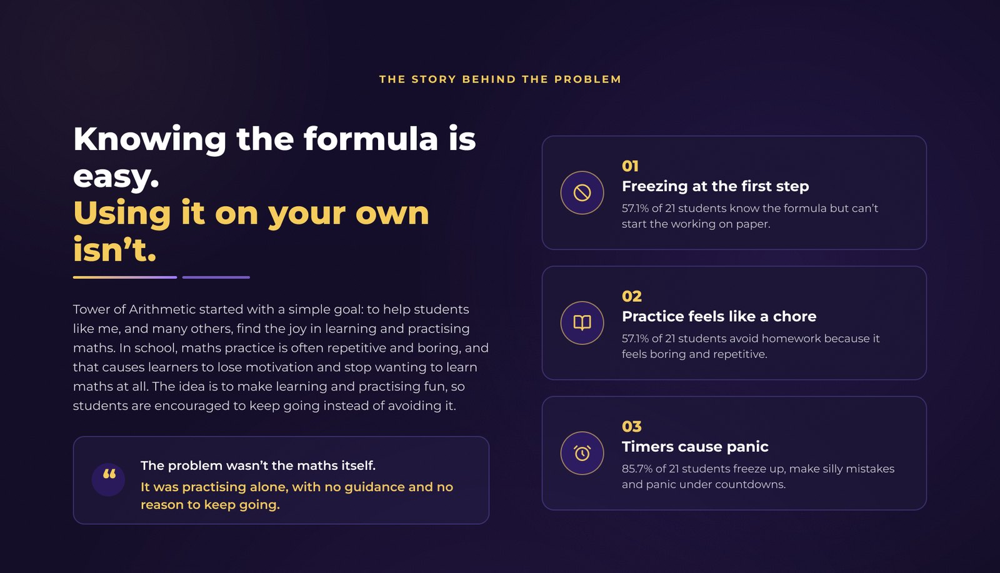

> **Knowing the formula is easy. Using it on your own isn't.**

In school, maths practice is often repetitive and boring, so learners lose motivation and stop wanting to practise. The problem isn't the maths itself: it's practising alone, with no guidance and no reason to keep going.

---

## 🔍 Research

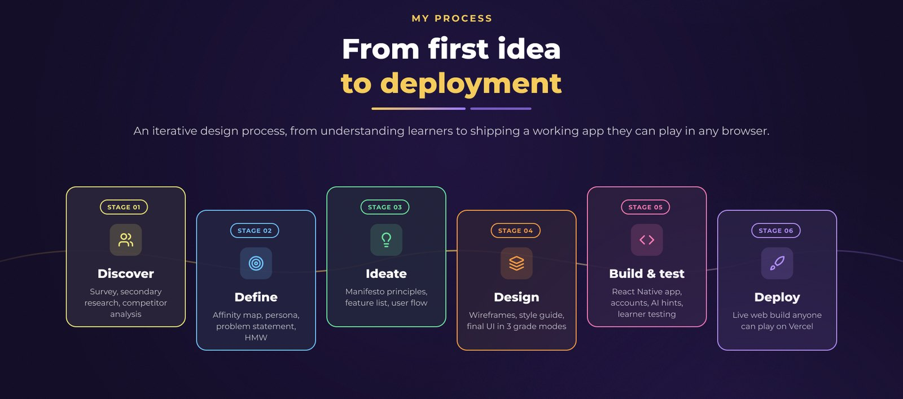

The project followed six stages: **Discover → Define → Ideate → Design → Build & test → Deploy**.

### 1. Survey: 21 learners

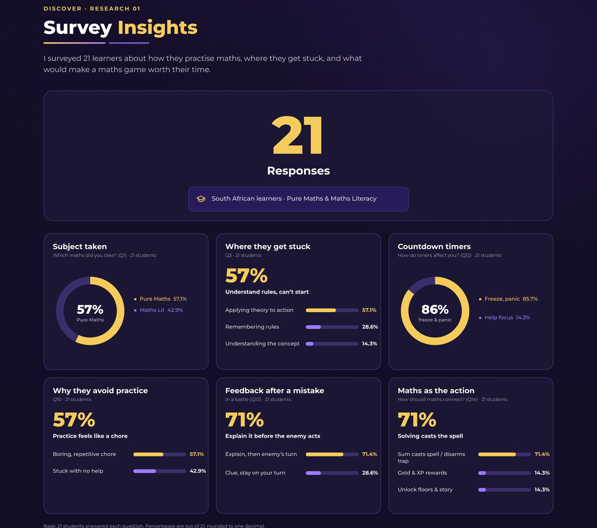

| Finding | Result (of 21 students) |
|---|---|
| Know the formula but can't start the working | **57.1%** |
| Freeze or panic under countdown timers | **85.7%** |
| Want the mistake explained before the enemy acts | **71.4%** |
| Want solving the sum to *be* the spell | **71.4%** |

### 2. Secondary research: maths anxiety, CAPS data & gamification

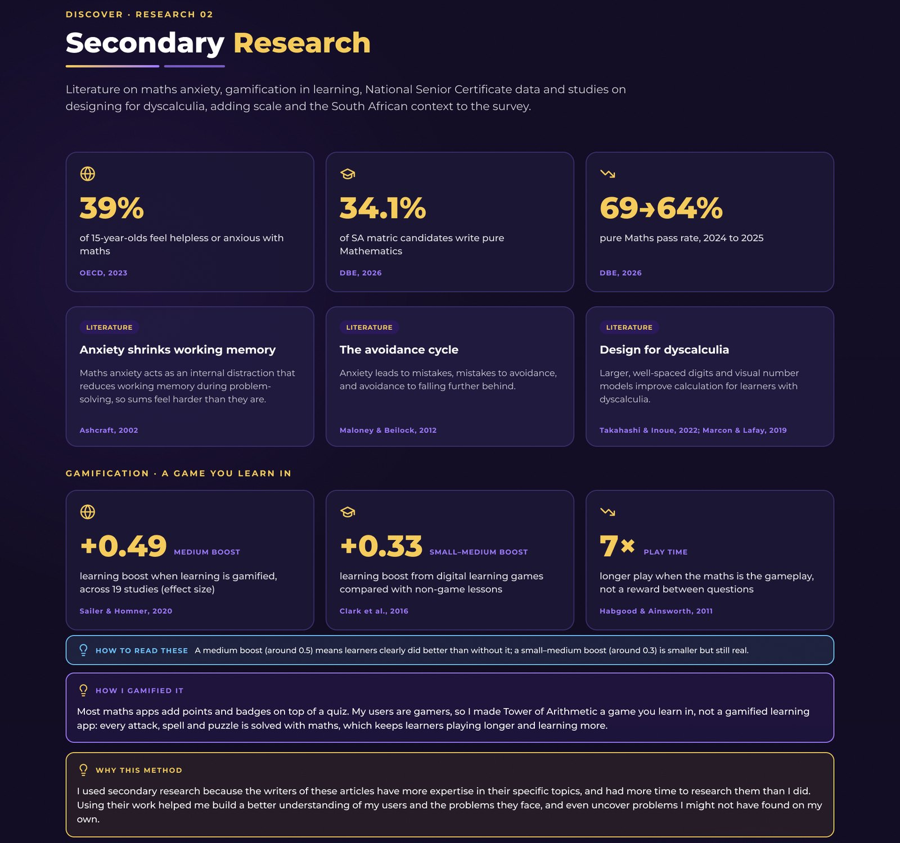

- **39%** of 15-year-olds feel helpless or anxious with maths (OECD, 2023).
- Only **34.1%** of South African matric candidates write pure Mathematics (DBE, 2026).
- Maths anxiety shrinks working memory (Ashcraft, 2002), which starts an avoidance cycle (Maloney & Beilock, 2012).
- **Gamified learning gives a medium boost to learning** (+0.49 effect size across 19 studies; Sailer & Homner, 2020).
- **Digital learning games beat non-game lessons** (+0.33; Clark et al., 2016).
- Children played about **7× longer** when the maths *was* the gameplay rather than a reward between questions (Habgood & Ainsworth, 2011).

### 3. Competitor analysis

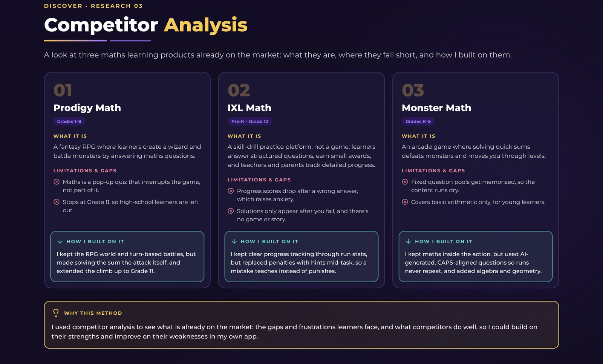

| Competitor | Gap | How Tower of Arithmetic builds on it |
|---|---|---|
| **Prodigy Math** | Maths is a pop-up quiz; stops at Grade 8 | Solving the sum *is* the attack; the climb goes up to Grade 11 |
| **IXL Math** | Scores drop after a wrong answer; no game | Hints mid-task instead of penalties; progress through run stats |
| **Monster Math** | Fixed question pools; basic arithmetic only | AI-generated CAPS questions; algebra and geometry |

---

## 🎯 Define: persona & problem statement

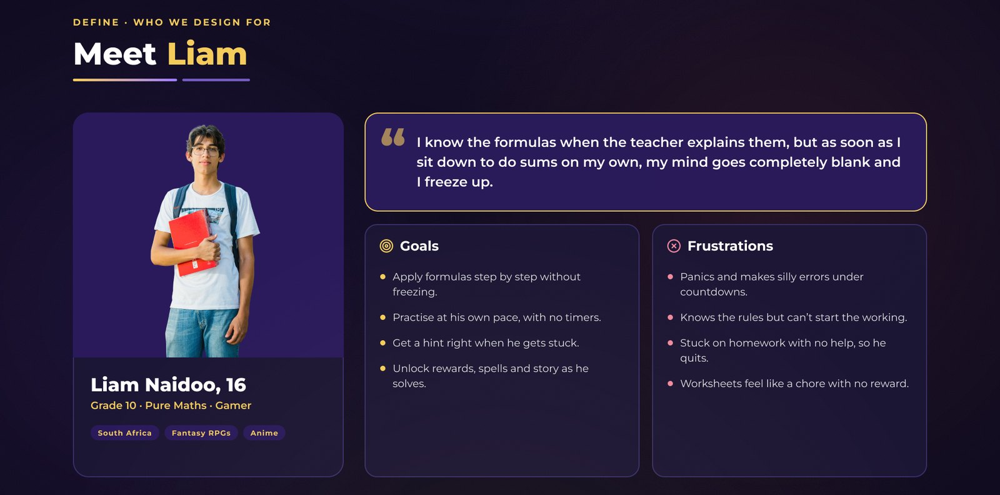

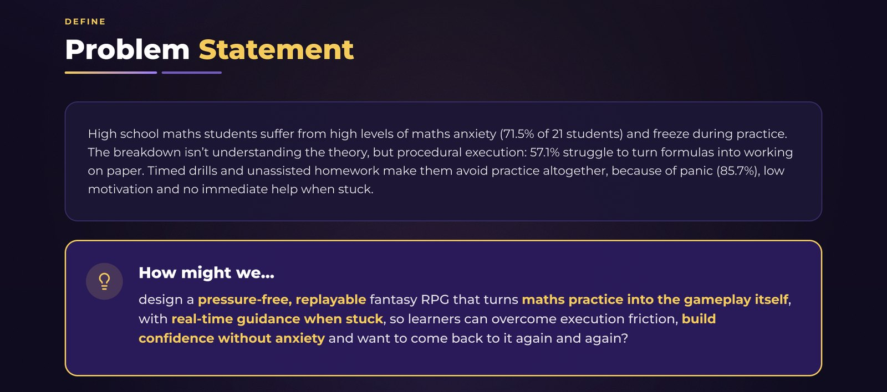

> **How might we** design a **pressure-free, replayable** fantasy RPG that turns **maths practice into the gameplay itself**, with **real-time guidance when stuck**, so learners can build **confidence without anxiety** and want to come back to it again and again?

---

## 🗺️ Planning: the wire flow

The flow is **modular**: any room (combat, puzzle, mystery, trader or campfire) can slot into any floor of the tower map, so **every run builds a new tower**. That is what makes the game replayable.

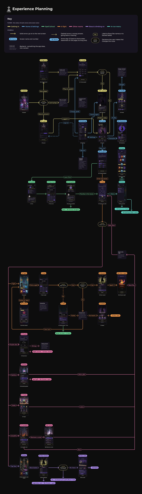

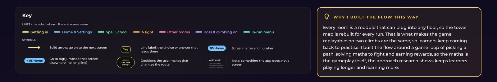

> 🎥 A scrolling video of the wire flow is in [`Documentation/planning`](Documentation/planning).

---

## 🎨 Style guide

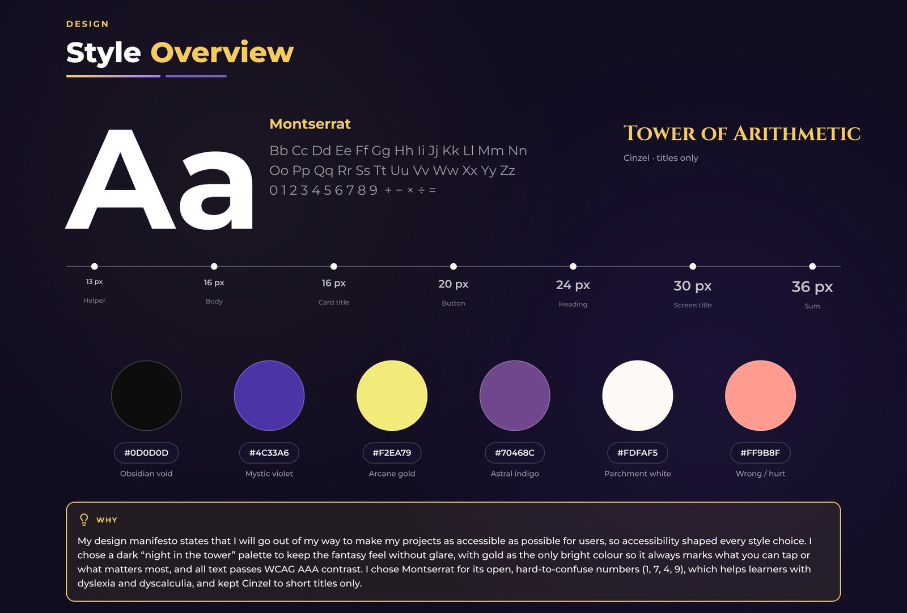

| Swatch | Name | Hex | Used for |
|---|---|---|---|
|  | Obsidian void | `#0D0D0D` | Backgrounds |
|  | Mystic violet | `#4C33A6` | Primary surfaces, selected states |
|  | Arcane gold | `#F2EA79` | Anything you can tap |
|  | Astral indigo | `#70468C` | Secondary accents |
|  | Parchment white | `#FDFAF5` | Text |
|  | Wrong / hurt | `#FF9B8F` | Wrong answers, damage |

- **Montserrat** for all text and numbers: open, hard-to-confuse digits (1, 7, 4, 9), which helps learners with dyslexia and dyscalculia.
- **Cinzel** for short titles only.
- All text passes **WCAG AAA** contrast. Gold is the only bright colour, so it always marks what you can tap.

---

## ✨ Features

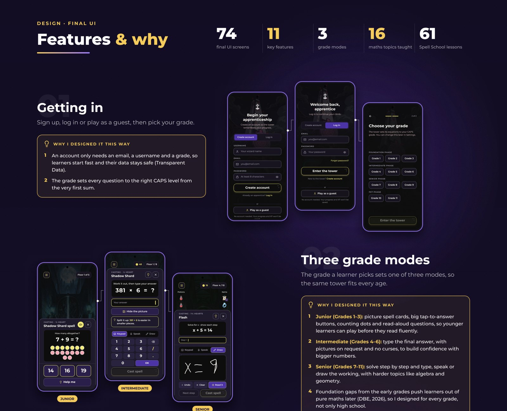

| | |
|---|---|
| **74** final UI screens | **11** key features |
| **3** grade modes | **16** maths topics |
| **61** Spell School lessons | **5** answer methods |

| # | Feature | What it does |
|---|---|---|
| 01 | **Getting in** | Sign up, log in or play as a guest, then pick your grade. The grade sets every question to the right CAPS level. |
| 02 | **Three grade modes** | **Junior (Gr 1–3):** picture cards, tap-to-answer and read-aloud. **Intermediate (Gr 4–6):** typed answers with picture help. **Senior (Gr 7–11):** solve step by step. |
| 03 | **Learn the tower** | A short tutorial, a hero to choose and a home base. |
| 04 | **Learn, then cast** | Spell School explains each topic with visuals before learners meet it in the tower. |
| 05 | **Climb your way** | Choose a dungeon topic (or a mixed dungeon), then pick a route up a tower map generated fresh every run. |
| 06 | **Answer your way** | Type, speak or draw your answer, so no one is blocked by one way of answering. |
| 07 | **Hints that teach** | A wrong answer gives an AI hint mid-task, without ending your turn or losing hearts. |
| 08 | **More than battles** | Puzzle doors, mystery events, traders and campfires between fights. |
| 09 | **Boss & rewards** | A boss at the top of each tower, plus XP, new spells and badges earned only by playing. |
| 10 | **Your account** | Profile, settings and full control of your data (edit, change password, delete account). |
| 11 | **Accessible by design** | Dyscalculia mode, picture hints, handwriting, speech, read-aloud and text size. |

---

## 📱 Mockups

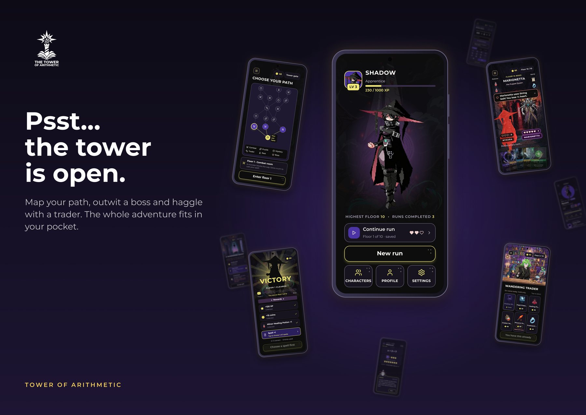

<table>
  <tr>
    <td>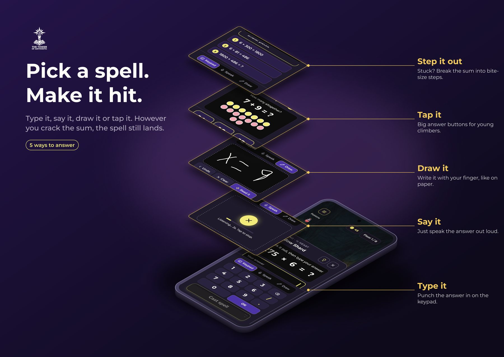</td>
    <td>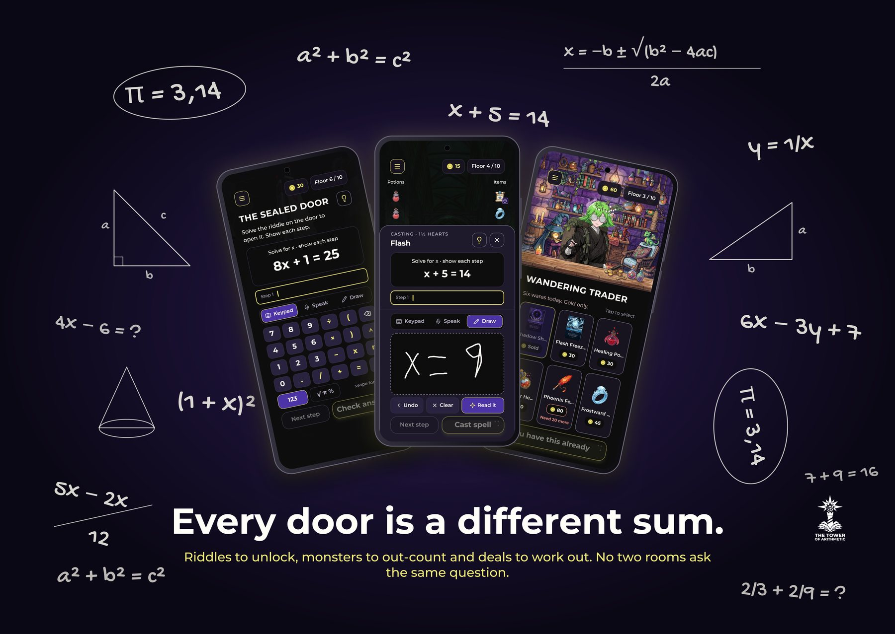</td>
  </tr>
  <tr>
    <td>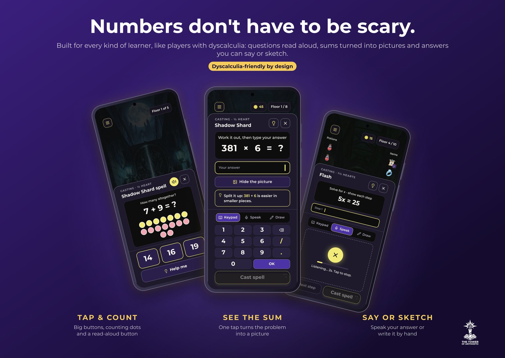</td>
    <td>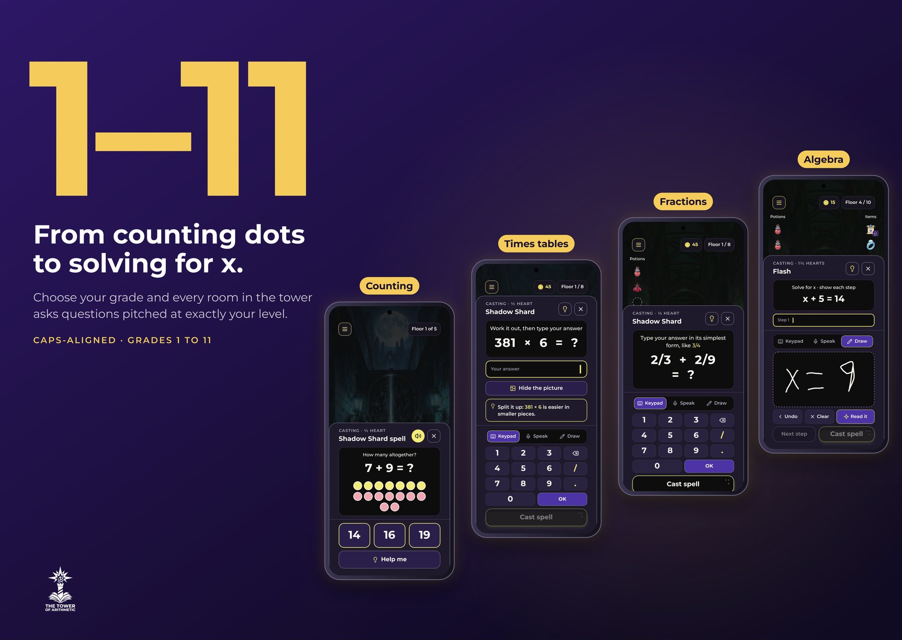</td>
  </tr>
</table>

---

## 🛠️ Tech stack & architecture

| Layer | Technology | Why |
|---|---|---|
| **App** | React Native 0.86 + **Expo SDK 57**, React 19 | One codebase for Android and web; fast iteration with Expo Go |
| **Web hosting** | **Vercel** (`npx expo export -p web`) | Free, instant deploys of the web build |
| **Backend** | **Node.js 20+ + Express 5**, hosted on **Render** | Keeps the Groq key off the phone and checks every AI answer |
| **Database & auth** | **Supabase** (PostgreSQL + Auth + row-level security) | Relational data for progress and stats, with built-in login |
| **AI** | **Groq API**: `openai/gpt-oss-20b` (questions, hints, summaries), `whisper-large-v3-turbo` (speech), a vision model (handwriting) | Very fast inference for turn-based play, on a free tier |
| **Other** | `react-native-svg`, `expo-audio`, `expo-speech`, `expo-video`, AsyncStorage | Drawing pad, recording, read-aloud, cutscenes, local saves |

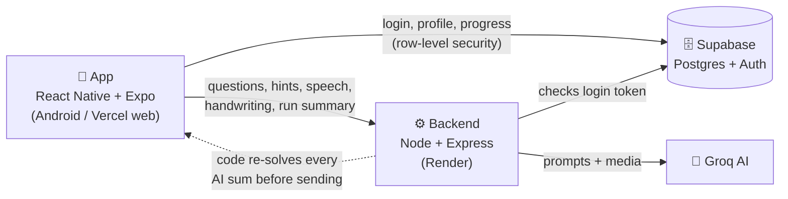

### Database (Supabase)

| Table | Holds |
|---|---|
| `profiles` | Username, grade, chosen hero, XP, level, highest floor, runs completed, tutorial done, settings |
| `character_progress` | Each hero's level and XP |
| `topic_progress` | Attempts, correct answers, total time and hints per maths topic and grade mode |
| `saved_runs` | A run in progress, so learners can continue later |

The full schema and privacy rules are in [`Backend/supabase/schema.sql`](Backend/supabase/schema.sql).

---

## 🧠 AI integration

| Route | What the AI does |
|---|---|
| `POST /api/questions` | Generates a batch of CAPS-aligned sums for the player's grade, topic and three difficulty levels. **Code works out every answer again** and throws away anything wrong, off topic or untypeable. |
| `POST /api/hint` | After a wrong answer, Orrin the Archmage explains the mistake in 1–2 sentences **without giving the answer**. |
| `POST /api/speech` | "Speak" answers: Whisper transcribes the recording, then code turns the words into keypad maths (`"x equals seven"` → `x = 7`). |
| `POST /api/handwriting` | "Draw" answers: the pen strokes are drawn as a picture and a vision model reads the maths. |
| `POST /api/run-summary` | Orrin's end-of-run advice. The strengths and the topic to practise are worked out by code; the AI only words it. |

**If the AI is unavailable, the game keeps working**: it falls back to its own sum generators, built-in hints and advice. Signed-in players and **guests** can both use every AI feature; guests get a smaller rate limit per device.

---

## 🚀 Getting started

### Requirements

- **Node.js 20+** and npm
- A **Supabase** project (free)
- A **Groq** API key (free): [console.groq.com](https://console.groq.com)
- **Expo Go** on your phone (optional, for testing on a device)

### 1. Clone

```bash
git clone https://github.com/andrevanheerden-061104/Tower-of-Arithmetic.git
cd Tower-of-Arithmetic
```

### 2. Database

In Supabase → **SQL Editor**, run [`Backend/supabase/schema.sql`](Backend/supabase/schema.sql), then [`update-2026-10-saved-runs-and-account.sql`](Backend/supabase/update-2026-10-saved-runs-and-account.sql).

### 3. Backend

```bash
cd Backend
cp .env.example .env      # fill in the values (see below)
npm install
npm test                  # 25 tests: maths checker, AI handling, login rules
npm run dev               # http://localhost:4000
```

### 4. App

```bash
cd ../Tower-of-Arithmetic
cp .env.example .env      # fill in the values (see below)
npm install
npx expo start            # press w for web, or scan the QR code with Expo Go
```

> On a phone, `localhost` is the phone itself: set `EXPO_PUBLIC_API_URL` to your computer's network address (e.g. `http://192.168.1.20:4000`) or the Render address.

---

## 🔐 Environment variables

> ⚠️ **Never commit `.env` files.** They are already in `.gitignore`. Only the `.env.example` files are committed.

**App** (`Tower-of-Arithmetic/.env`): only `EXPO_PUBLIC_` values are built into the app, so **no secret keys go here**.

| Variable | Description |
|---|---|
| `EXPO_PUBLIC_SUPABASE_URL` | Your Supabase project URL |
| `EXPO_PUBLIC_SUPABASE_PUBLISHABLE_KEY` | Supabase **publishable** key (safe in the app) |
| `EXPO_PUBLIC_API_URL` | Backend address (Render URL, or your computer's IP while testing) |

**Backend** (`Backend/.env`): server only.

| Variable | Description |
|---|---|
| `PORT` | Port to listen on (Render sets this itself) |
| `SUPABASE_URL` / `SUPABASE_PUBLISHABLE_KEY` | Used to check login tokens |
| `GROQ_API_KEY` | 🔒 Secret: the Groq key never leaves the server |
| `GROQ_MODEL` | Chat model for questions, hints and summaries (default `openai/gpt-oss-20b`) |
| `GROQ_SPEECH_MODEL` | Speech-to-text model (default `whisper-large-v3-turbo`) |
| `GROQ_VISION_MODEL` | Vision model for handwriting |
| `ALLOWED_ORIGINS` | Websites allowed to call the API (comma separated, `*` for all) |

---

## 🌍 Deployment

| Part | Host | How |
|---|---|---|
| **Web app** | Vercel | Root directory `Tower-of-Arithmetic`; build command and output come from [`vercel.json`](Tower-of-Arithmetic/vercel.json). Add the three `EXPO_PUBLIC_` variables in Vercel → Settings → Environment Variables. |
| **Backend** | Render | Web Service, root directory `Backend`, build `npm install`, start `npm start`, health check `/health`. Full steps in [`Backend/README.md`](Backend/README.md). |
| **Android** | EAS Build | See below. |

> Render's free servers sleep after 15 minutes. Open the app (or `/health`) a minute before a demo; the game plays with its own questions until the server wakes up.

---

## 🤖 Build the Android APK

The full step-by-step guide is in **[`Documentation/build-android-apk.md`](Documentation/build-android-apk.md)**. In short:

```bash
npm install -g eas-cli
cd Tower-of-Arithmetic
eas login
eas init                                   # links the app to your Expo account (first time only)
eas build -p android --profile preview     # builds an installable .apk in the cloud
```

When the build finishes, open the link EAS gives you **on your Android phone**, download the `.apk` and install it.

---

## 📁 Project structure

```
Tower-of-Arithmetic/
├── Tower-of-Arithmetic/          # 📱 the Expo app
│   ├── App.js                    # app entry: fonts, settings, sound and the screens
│   ├── app.json · eas.json       # Expo + Android build settings
│   ├── vercel.json               # web build on Vercel
│   └── src/
│       ├── screens/              # splash, login, signup, onboarding, tutorial, home,
│       │                         # characters, profile, settings, account, lesson, TowerFloors…
│       ├── components/           # UI pieces (run/answer = keypad, speak, draw pads)
│       ├── game/                 # map generator, rooms, encounters, enemy AI, spells, items,
│       │                         # question pool + generators per grade mode
│       ├── data/                 # characters, badges, levels, lessons, tutorial steps
│       ├── context/ · hooks/     # player, text size, dyscalculia and motion settings; AI hints, voice answers
│       ├── services/             # AI calls, player data (Supabase)
│       ├── lib/                  # API + Supabase clients
│       ├── audio/                # music, sound effects, read-aloud
│       └── theme/                # colours, type, spacing
├── Backend/                      # ⚙️ Node + Express API (see Backend/README.md)
│   ├── src/ai · maths · routes · middleware · lib
│   ├── supabase/                 # database schema
│   └── test/                     # node --test
└── Documentation/                # 📚 design & project documentation
```

---

## 🔄 Changes from the product pitch

The design changed during research and testing. These were deliberate decisions, not missing features:

| Pitch | Final app | Why |
|---|---|---|
| Quick-time events (timed shields) | **No timers at all** | 85.7% of surveyed learners freeze or panic under countdowns |
| Trap-disarming rooms | **Puzzle doors, mystery events, traders and campfires** | More variety between fights, and puzzle doors cost no hearts |
| Edge-TTS Archmage voice | **Built-in read-aloud** (`expo-speech`) plus recorded tutorial voice | Works offline and on every device, with no extra server |
| Educator/parent data dashboard | **Run stats for the learner** (accuracy per floor, errors per topic) | Scoped to the learner for the six-week build; the dashboard is future work |
| Llama 3 8B | **`openai/gpt-oss-20b` on Groq** (set by `GROQ_MODEL`) | The model can be swapped in `.env` without changing code |

---

## 🔭 Future work

- 📊 **Educator & parent dashboard** built on the existing `topic_progress` data.
- 🧩 Features for learners with **other learning disabilities**, such as dyslexia.
- 🌍 **More maths syllabi** beyond CAPS (e.g. Common Core, GCSE).
- ⚔️ A **1v1 duel arena** and classroom leaderboards.

---

## 📚 Documentation

More design and project documentation lives in the **[`Documentation`](Documentation)** folder:

| Folder | Contents |
|---|---|
| [`style-guide/`](Documentation/style-guide) | Colours, type, components and UI kit |
| [`research/`](Documentation/research) | Survey, secondary research, competitor analysis, findings |
| [`planning/`](Documentation/planning) | Experience planning, wire flow, ERD, roadmap |
| [`wireframes/`](Documentation/wireframes) | Annotated wireframes and design development |
| [`ui-screens/`](Documentation/ui-screens) | Final UI screens |
| [`build-android-apk.md`](Documentation/build-android-apk.md) | How to build and install the APK |

---

## 📖 References

- Ashcraft, M. H. (2002). Math anxiety: Personal, educational, and cognitive consequences. *Current Directions in Psychological Science, 11*(5), 181–185.
- Clark, D. B., Tanner-Smith, E. E., & Killingsworth, S. S. (2016). Digital games, design, and learning: A systematic review and meta-analysis. *Review of Educational Research, 86*(1), 79–122.
- Habgood, M. P. J., & Ainsworth, S. E. (2011). Motivating children to learn effectively: Exploring the value of intrinsic integration in educational games. *Journal of the Learning Sciences, 20*(2), 169–206.
- Maloney, E. A., & Beilock, S. L. (2012). Math anxiety: Who has it, why it develops, and how to guard against it. *Trends in Cognitive Sciences, 16*(8), 404–406.
- OECD. (2023). *PISA 2022 Results (Volume I)*. OECD Publishing.
- Sailer, M., & Homner, L. (2020). The gamification of learning: A meta-analysis. *Educational Psychology Review, 32*(1), 77–112.

---

<div align="center">

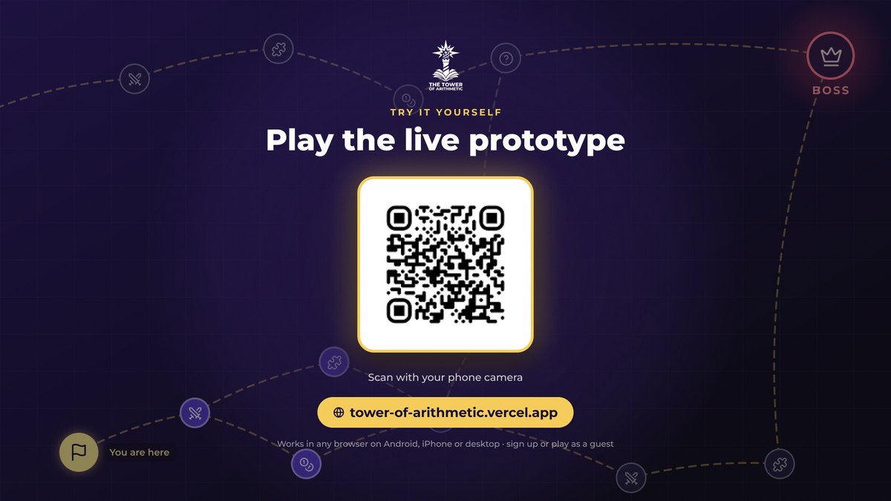

**Andre van Heerden** · UX Design & Interactive Development · Open Window, 2026

*Climb the tower. Cast spells with maths.*

</div>
