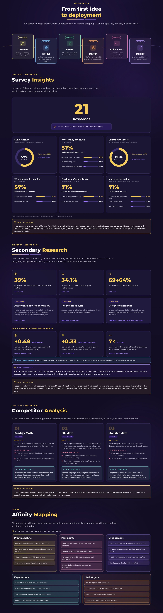
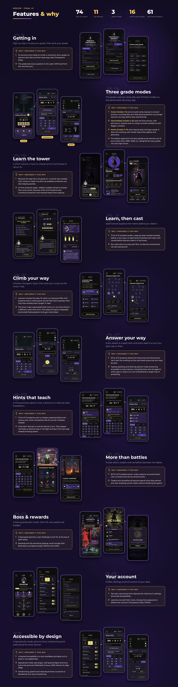
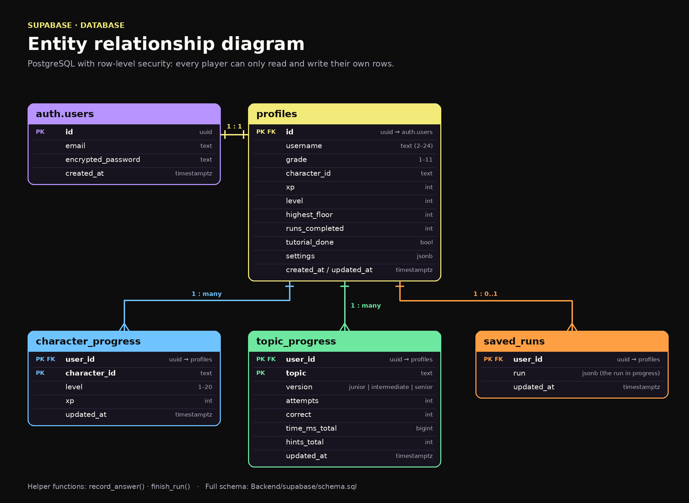

<div align="center">


[](https://tower-of-arithmetic.vercel.app)


**Grades 1–11 · CAPS-aligned · Dyscalculia-friendly · Android & web**

</div>

---

<div align="center">

### Contents

<a href="#about"></a>
<a href="#problem"></a>
<a href="#research"></a>
<a href="#define"></a>
<a href="#wireflow"></a>
<a href="#style"></a>
<a href="#features"></a>
<a href="#mockups"></a>
<a href="#tech"></a>
<a href="#database"></a>
<a href="#ai"></a>
<a href="#deployment"></a>
<a href="#structure"></a>
<a href="#changes"></a>
<a href="#future"></a>
<a href="#play"></a>
<a href="#credits"></a>
<a href="#references"></a>

</div>

---

<a id="about"></a>

## 🧙 About the project

**Tower of Arithmetic** is a learning app that turns maths practice into a turn-based fantasy RPG. You play a wizard's apprentice climbing a tower of floors, and every attack, spell and puzzle door is cast by solving a sum. The maths *is* the gameplay, not a quiz that interrupts it.

| | |
|---|---|
| **Category** | Education & EdTech (game-based learning) |
| **Audience** | Learners in Grades 1–11 (ages 6–17), especially those with maths anxiety |
| **Curriculum** | South African CAPS, three grade modes (Junior, Intermediate, Senior) |
| **Platforms** | Android (APK) and web |
| **App** | React Native + Expo SDK 57 |
| **AI** | Groq API: `openai/gpt-oss-20b` (questions, hints, run advice), Whisper (speech answers), a vision model (handwritten answers) |
| **Database & login** | Supabase (PostgreSQL + Auth, row-level security) |
| **Backend** | Node.js + Express, hosted on Render |
| **Web hosting** | Vercel |
| **Live prototype** | **[tower-of-arithmetic.vercel.app](https://tower-of-arithmetic.vercel.app)**: sign up or play as a guest |

---

<a id="problem"></a>

## 🧩 The problem


---

<a id="research"></a>

## 🔍 Process & research



---

<a id="define"></a>

## 🎯 Who we design for


---

<a id="wireflow"></a>

## 🗺️ Wire flow


---

<a id="style"></a>

## 🎨 Style guide


---

<a id="features"></a>

## ✨ Features & why



---

<a id="mockups"></a>

## 📱 Mockups


<table>
  <tr>
    <td></td>
    <td></td>
  </tr>
  <tr>
    <td></td>
    <td></td>
  </tr>
</table>

---

<a id="tech"></a>

## 🛠️ Tech stack

| Layer | Technology | Why |
|---|---|---|
| **App** | React Native 0.86 + **Expo SDK 57**, React 19 | One codebase for Android and web; fast iteration with Expo Go |
| **Web hosting** | **Vercel** (`npx expo export -p web`) | Free, instant deploys of the web build |
| **Backend** | **Node.js 20+ + Express 5**, hosted on **Render** | Keeps the Groq key off the phone and checks every AI answer |
| **Database & auth** | **Supabase** (PostgreSQL + Auth + row-level security) | Relational data for progress and stats, with built-in login |
| **AI** | **Groq API**: `openai/gpt-oss-20b`, `whisper-large-v3-turbo`, a vision model | Very fast inference for turn-based play, on a free tier |
| **Builds** | **EAS Build** | Cloud builds of the Android APK |
| **Other** | `react-native-svg`, `expo-audio`, `expo-speech`, `expo-video`, AsyncStorage | Drawing pad, recording, read-aloud, cutscenes, local saves |

---

<a id="database"></a>

## 🗄️ Database



| Table | Holds |
|---|---|
| `profiles` | Username, grade, chosen hero, XP, level, highest floor, runs completed, tutorial done, settings |
| `character_progress` | Each hero's level and XP |
| `topic_progress` | Attempts, correct answers, total time and hints per maths topic and grade mode |
| `saved_runs` | A run in progress, so learners can continue later |

---

<a id="ai"></a>

## 🧠 AI integration

| Route | What the AI does |
|---|---|
| `POST /api/questions` | Generates a batch of CAPS-aligned sums for the player's grade, topic and three difficulty levels. **Code works out every answer again** and throws away anything wrong, off topic or untypeable. |
| `POST /api/hint` | After a wrong answer, Orrin the Archmage explains the mistake in 1–2 sentences **without giving the answer**. |
| `POST /api/speech` | "Speak" answers: Whisper transcribes the recording, then code turns the words into keypad maths (`"x equals seven"` → `x = 7`). |
| `POST /api/handwriting` | "Draw" answers: the pen strokes are drawn as a picture and a vision model reads the maths. |
| `POST /api/run-summary` | Orrin's end-of-run advice. The strengths and the topic to practise are worked out by code; the AI only words it. |

**If the AI is unavailable, the game keeps working**: it falls back to its own sum generators, built-in hints and advice. Signed-in players and **guests** can both use every AI feature; guests get a smaller rate limit per device.

---

<a id="deployment"></a>

## 🌍 Deployment

| Part | Hosted on | Link / details |
|---|---|---|
| **Web app** | Vercel | **[tower-of-arithmetic.vercel.app](https://tower-of-arithmetic.vercel.app)** |
| **Backend API** | Render | Node + Express web service (root `Backend`, health check `/health`) |
| **Database & login** | Supabase | PostgreSQL with row-level security |
| **AI** | Groq | Called only from the backend, so the key never reaches the phone |

---

<a id="structure"></a>

## 📁 Project structure

```
Tower-of-Arithmetic/
├── Tower-of-Arithmetic/          # 📱 the Expo app
│   ├── App.js                    # app entry: fonts, settings, sound and the screens
│   ├── app.json · eas.json       # Expo + Android build settings
│   ├── vercel.json               # web build on Vercel
│   └── src/
│       ├── screens/              # splash, login, signup, onboarding, tutorial, home,
│       │                         # characters, profile, settings, account, lesson, TowerFloors…
│       ├── components/           # UI pieces (run/answer = keypad, speak, draw pads)
│       ├── game/                 # map generator, rooms, encounters, enemy AI, spells, items,
│       │                         # question pool + generators per grade mode
│       ├── data/                 # characters, badges, levels, lessons, tutorial steps
│       ├── context/ · hooks/     # player, text size, dyscalculia and motion settings; AI hints, voice answers
│       ├── services/             # AI calls, player data (Supabase)
│       ├── lib/                  # API + Supabase clients
│       ├── audio/                # music, sound effects, read-aloud
│       └── theme/                # colours, type, spacing
├── Backend/                      # ⚙️ Node + Express API (see Backend/README.md)
│   ├── src/ai · maths · routes · middleware · lib
│   ├── supabase/                 # database schema
│   └── test/                     # node --test
└── Documentation/                # 📚 research, planning and style guide PDFs
```

---

<a id="changes"></a>

## 🔄 Changes from the product pitch

The design changed during research and testing. These were deliberate decisions, not missing features:

| Pitch | Final app | Why |
|---|---|---|
| Quick-time events (timed shields) | **No timers at all** | 85.7% of surveyed learners freeze or panic under countdowns |
| Trap-disarming rooms | **Puzzle doors, mystery events, traders and campfires** | More variety between fights, and puzzle doors cost no hearts |
| Edge-TTS Archmage voice | **Built-in read-aloud** (`expo-speech`) plus recorded tutorial voice | Works offline and on every device, with no extra server |
| Educator/parent data dashboard | **Run stats for the learner** (accuracy per floor, errors per topic) | Scoped to the learner for the six-week build |
| Llama 3 8B | **`openai/gpt-oss-20b` on Groq** (set by `GROQ_MODEL`) | The model can be swapped in `.env` without changing code |

---

<a id="future"></a>

## 🔭 Future work

- 📚 **Beyond CAPS:** build on the CAPS system and add more maths areas and other countries' syllabi, so learners outside South Africa can play too.
- 🧸 **A more child-friendly Junior mode:** a softer art style made for Grades 1–3.
- 👾 **More creatures and monsters** to battle as you climb.
- ⚔️ **A 1v1 duel arena** where two apprentices race to solve sums.
- ♿ **More learning disabilities:** go beyond dyscalculia and design for other conditions that affect maths, such as dyslexia.

---

<a id="play"></a>

<div align="center">

## ▶️ Play it


**[tower-of-arithmetic.vercel.app](https://tower-of-arithmetic.vercel.app)**

</div>

---

<a id="credits"></a>

## 🙏 Credits

| Role | Name |
|---|---|
| **Designer & developer** | Andre van Heerden · UX Design & Interactive Development, Open Window |
| **Development lecturer** | Tsunga · *email* |
| **UX lecturer** | Laudette Sass · *email* |

---

<a id="references"></a>

## 📖 References

- Ashcraft, M. H. (2002). Math anxiety: Personal, educational, and cognitive consequences. *Current Directions in Psychological Science, 11*(5), 181–185.
- Clark, D. B., Tanner-Smith, E. E., & Killingsworth, S. S. (2016). Digital games, design, and learning: A systematic review and meta-analysis. *Review of Educational Research, 86*(1), 79–122.
- Department of Basic Education (DBE). (2026). *National Senior Certificate (NSC) 2025 Examination Diagnostic & Technical Report.* Pretoria: Republic of South Africa.
- Habgood, M. P. J., & Ainsworth, S. E. (2011). Motivating children to learn effectively: Exploring the value of intrinsic integration in educational games. *Journal of the Learning Sciences, 20*(2), 169–206.
- Käser, T., Baschera, G.-M., Kohn, J., Kucian, K., Richtmann, V., Grond, U., Gross, M., & von Aster, M. (2013). Design and evaluation of the computer-based training program Calcularis for enhancing numerical cognition. *Frontiers in Psychology, 4*, 489.
- Maloney, E. A., & Beilock, S. L. (2012). Math anxiety: Who has it, why it develops, and how to guard against it. *Trends in Cognitive Sciences, 16*(8), 404–406.
- Marcon, L., & Lafay, A. (2019). Math learning disabilities and number line: Systematic review of literature. *Glossa, 124*, 34–52.
- Naicker, S. (2026). *Analysis of NSC Gateway Subject Throughput and Learner Retention.* Johannesburg: University of Johannesburg Faculty of Education.
- OECD. (2023). *PISA 2022 Results (Volume I): The State of Learning and Equity in Education.* Paris: OECD Publishing.
- Parker, L. (2022). *Designing for people with dyscalculia and low numeracy.* UK Government Design Notes.
- Sailer, M., & Homner, L. (2020). The gamification of learning: A meta-analysis. *Educational Psychology Review, 32*(1), 77–112.
- Takahashi, M., & Inoue, S. (2022). How can visual perception of numbers affect computational fluency? *Proceedings of the Annual Meeting of the Cognitive Science Society, 44.*
